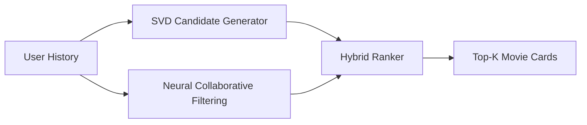

# Movie Recommendation Engine: Hybrid SVD & Neural Collaborative Filtering


A personalized multi-stage recommendation service blending matrix factorization with neural collaborative embeddings and content attributes.

## Architecture


## Start API
```bash
uvicorn src.api.service:app --reload
curl http://localhost:8000/recommend/42?count=5
```
